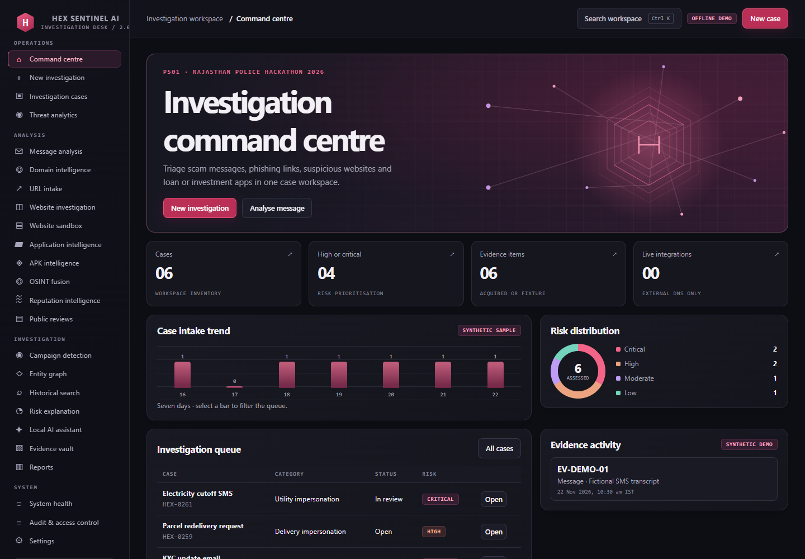
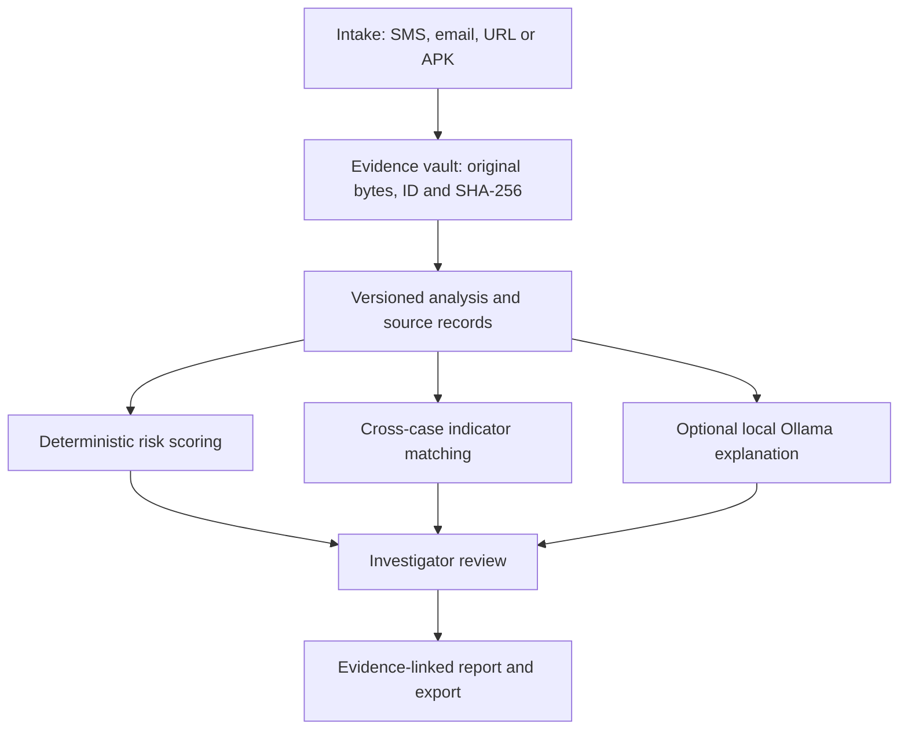
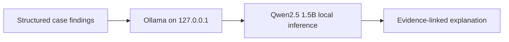

# HEX SENTINEL AI

**Explainable cyber-fraud triage and digital evidence investigation**  
Rajasthan Police Cyber Security Hackathon 2026 · PS01 · Screening round

HEX SENTINEL AI brings scam messages, phishing links, suspicious websites and potentially fraudulent Android apps into one investigation workflow. An investigator can preserve the original evidence, see which signals raised the risk score, compare indicators across cases and export a report with traceable findings.

[Download the 22-slide action plan](submission/HEX_SENTINEL_AI_Action_Plan.pptx) · [Download the offline prototype](submission/HEX_SENTINEL_AI_HTML_Prototype.zip) · [Local AI and data handling](#local-ai-and-data-handling) · [Website observation sandbox](#website-observation-sandbox)

## Investigation command centre



*Screenshot from the offline prototype, captured with fictional data for the action plan.*

## How an investigation works



| Area | What investigators can see or do |
| --- | --- |
| Evidence intake and custody | Store original evidence with a SHA-256 digest, preserve analysis revisions and review integrity checks, role scopes and local audit events. |
| Message and email analysis | Review urgency, impersonation, OTP or payment requests and candidate contact or payment identifiers. |
| Links and domain intelligence | Review source-labelled observations such as DNS and supported RDAP records. The action plan also describes IP/ASN, certificate transparency and bounded website document collection. Coverage depends on the configured source. |
| Website observation | Review redirect information, TLS metadata, form metadata and an inert snapshot where available. |
| Android app and APK review | Inspect manifest declarations, sensitive permissions, component flags and package identifiers. Supported public catalogues can provide version records. The action plan includes optional network-isolated signer verification. |
| OSINT and public reviews | Keep source references, retrieval context and provenance with each observation. Analyst-supplied public reviews can be grouped by theme and reviewed as opinions. |
| Risk explanation | Show the rule, evidence reference and contribution behind the risk rating. Use the rating to prioritise analyst review. |
| Related cases and entity graph | Compare typed indicators such as payment IDs, contacts, packages, certificate fingerprints and domains. Review both evidence references and explore candidate links in a 2D or 3D view. |
| Local AI assistant | Ask case questions or generate an evidence-referenced explanation from structured findings. Deterministic scoring remains independent of model output. |
| Case handoff | Prepare executive and technical reports. The action plan describes PDF, JSON, indicator CSV and printable HTML outputs, with version and digest information for connected exports. |

## Local AI and data handling

The connected prototype can use **Qwen2.5 1.5B Instruct** through **Ollama**. The application sends structured case facts to Ollama on IPv4 loopback and inference runs on the same machine. Case prompts and findings stay on the machine during inference and are never sent to a cloud AI provider through this flow. Responses reference evidence IDs. The application can fall back to a deterministic explanation when the local model is unavailable or disabled.



For an existing connected installation, download the model once, then configure the model name in the same PowerShell session used to launch the application.

```powershell
ollama pull qwen2.5:1.5b
$env:HEX_OLLAMA_MODEL = "qwen2.5:1.5b"
```

The initial model download requires network access. The offline demo uses labelled fictional fixtures and performs zero external requests. Connected public-source lookups are separately configured and may send the requested indicator, such as a domain, to a resolver or other public provider when an investigator opts in.

## Website observation sandbox

The design gives the public-document gateway and the renderer separate jobs. The gateway collects bounded public document metadata from supported destinations. The renderer turns extracted text into an inert view in a disposable, resource-limited container with a read-only filesystem, no host mounts, no external network and no execution of the site's JavaScript. This lets an investigator inspect content without opening the original page in their normal browser. Snapshot and metadata availability depend on source coverage and worker configuration.

## Run the offline prototype

1. [Download the prototype ZIP](submission/HEX_SENTINEL_AI_HTML_Prototype.zip) and extract all files into one folder.
2. Open `index.html` from that folder in Chrome or Edge. Keep its CSS and JavaScript alongside it.
3. Start with **Electricity cutoff SMS**. Try **Risk Explanation**, **Entity Graph** and **Reports**, then open **Investment wallet site** for the synthetic replay.

The [prototype source](prototype/) is included for review. The ZIP runs locally without a server or account. Website replay, public-source records and the model preview are synthetic in this build. The live Ollama integration and isolated renderer described above belong to the connected application design documented in the action plan.

## Demo walkthrough

1. Open the fictional **Electricity cutoff SMS** case.
2. Inspect the original message and its evidence ID. Review the threat of disconnection, payment request, OTP request and suspicious link.
3. Expand the risk explanation. The action plan shows a **91/100** rating for this synthetic case and lists the contribution from each rule.
4. Review candidate links to other cases, check the evidence references and export the report.

## Prototype and roadmap

The action plan records prototype verification for original evidence retention, typed indicator matching, local Qwen inference, selected public lookups, and inert rendering. Provider coverage, public document collection and scoring are limited. Broader reputation feeds, OCR, semantic retrieval and production identity controls are roadmap items.

[Full action plan, including architecture, operating modes and evaluation criteria](submission/HEX_SENTINEL_AI_Action_Plan.pptx)
